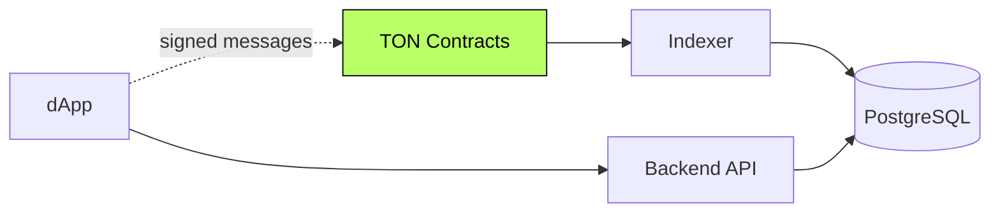

<div align="center">

```
   ████████╗ ██████╗ ███╗   ██╗
   ╚══██╔══╝██╔═══██╗████╗  ██║
      ██║   ██║   ██║██╔██╗ ██║
      ██║   ██║   ██║██║╚██╗██║
      ██║   ╚██████╔╝██║ ╚████║
      ╚═╝    ╚═════╝ ╚═╝  ╚═══╝
```

# TON Launchpad

#### A token launchpad built natively on **TON.**
#### Contracts in FunC / Tact · backend in NestJS · frontend in Next.js.

[](#)
[](#)
[](#)
[](#)

</div>

---

> **TL;DR** — A token launchpad on TON, built end-to-end. TON's account
> model differs sharply from EVM and Solana, and this is the system that
> handles it natively.

---

## Overview

A TON-native launchpad covering on-chain contracts (FunC / Tact), an
indexer and backend, and a user-facing dApp. Designed to fit TON's
asynchronous, contract-per-account execution model rather than fight it.

> This repository documents the system at the **architectural level**.
> Implementation code is private.

---

## My Role

> **Full-stack Engineer.** End-to-end ownership on TON.

- TON contract architecture (FunC / Tact)
- Backend integration (TON SDK, indexer patterns)
- Frontend dApp and wallet integration
- Sale lifecycle across TON's async model

---

## Architecture



---

## Capabilities

- **TON-native sale logic** — designed around TON's async semantics
- **Vesting & claim** — schedules executed via on-chain contract messages
- **Indexed view** — backend serves a coherent view of an async ledger
- **TON wallet integration** — TonConnect-style flow

---

## Architectural Decisions & Tradeoffs

### 1. Designed for TON's async model, not against it

TON contracts communicate via messages, asynchronously. Forcing a
synchronous mental model creates impossible bugs. The system was designed
around message-passing semantics from day one.

### 2. Backend reconciles, doesn't dictate

The backend doesn't tell the chain what to do — it observes what happened
and reconciles. Source of truth stays on-chain.

### 3. Tact for new modules, FunC where it matters

Tact for ergonomics, FunC where bytecode footprint or audit clarity calls
for it.

---

## Engineering Invariants

- **Never** assume synchronous semantics on TON
- **Never** display state derived from a single message as final
- **Never** rebuild on-chain state without reconciliation against the chain

---

## Related Public Documents

- [`multichain-contracts`](https://github.com/eldardzh/multichain-contracts) — contract index across chains
- [`weway-launchpad`](https://github.com/eldardzh/weway-launchpad) — multichain launchpad this fed into

---

<div align="center">

#### **Contact**
[**eldardzh.com**](https://eldardzh.com) · [**@EldarDissmay**](https://x.com/EldarDissmay) · **dissmay21@gmail.com**

<sub>© 2026 · Eldar D.</sub>

</div>
